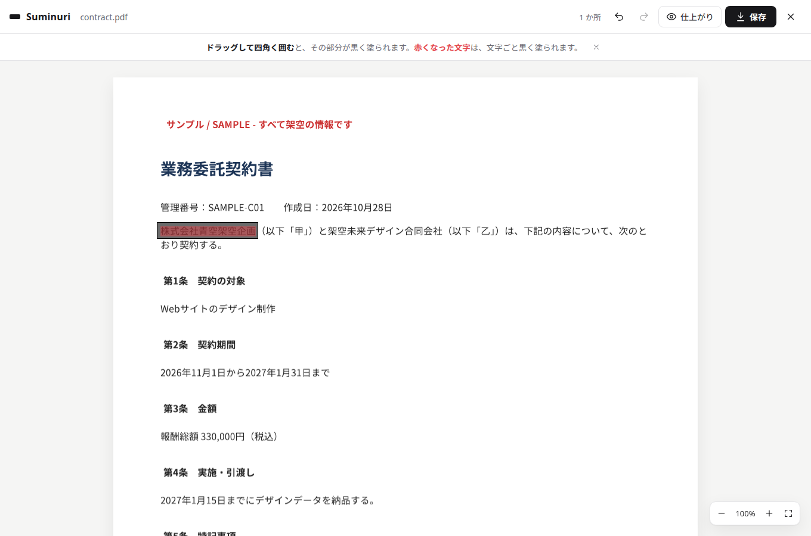

# Suminuri（墨塗り）

**隠したい所を、四角で囲むだけ。** PDF や画像の個人情報を、ブラウザの中だけで黒く塗ります。ファイルはどこにも送られません。

**使ってみる → https://aero123421.github.io/Suminuri/**



## 使い方

1. PDF・PNG・JPEG を開く（ドロップでも可）
2. 隠したい所をドラッグして四角く囲む
3. 「保存」を押す

- 四角は動かす・角で大きさを変える・× で外すことができます。`Ctrl+Z` で元に戻せます。
- PDF では、四角にかかった文字が**赤く**表示されます。赤い文字は、保存すると文字ごと黒く塗られます。
- 「仕上がり」を押すと、保存したときの見た目を確認できます。
- スマートフォンでは、指でなぞるとスクロール、少し長押ししてからなぞると四角が描けます。

自動で個人情報を探す機能はありません。何を隠すかは、使う人が決めます。

## 保存したファイルに残らないもの

- **PDF**：各ページを画像にした新しい PDF として保存します。塗った所は見た目も文字のデータも残りません。元の文字のデータ・注釈・フォーム・添付ファイル・しおり・作成者などの情報も入りません（塗っていない所も画像になるため、文字の選択やコピーはできなくなります）。
- **画像**：画素から作り直すので、撮影日時・位置情報（EXIF）・コメントなどは残りません。

保存の直後に、保存したファイルを開き直して「文字のデータが残っていないか」「塗った所がすべて黒いか」を確かめ、結果を表示します。

## プライバシー

- すべての処理はブラウザの中で行います。サーバーにファイルを送る機能はありません。
- ページの Content-Security-Policy で、ほかのサイトへの通信を禁止しています。開発者ツールのネットワークタブで確かめられます。
- 保存するのは「使い方の案内を閉じたか」だけです（ブラウザの localStorage）。

## 制限

- 対応形式：PDF・PNG・JPEG（Excel・Word は準備中）。パスワード付きの PDF は開けません。
- 赤い文字の位置は、PDF の文字データから見積もったものです。フォームの入力欄の文字などは赤くならないことがあります。四角の中は、赤い表示に関係なく必ず黒く塗られます。
- 大きすぎる画像（5,000 万画素超）や 500 ページを超える PDF は開けません。

## 開発

```bash
npm ci
npm run dev          # http://127.0.0.1:5173
npm run build        # dist/ に静的サイト
npm test             # 単体テスト
npm run preview -- --port 4180 & node tests/e2e.mjs   # ブラウザでの通し試験（Chromium と Poppler が必要）
```

React・Vite・[PDF.js](https://github.com/mozilla/pdf.js)・[pdf-lib](https://github.com/Hopding/pdf-lib) で作っています。`dist/` はどの静的ホストにも置けます。

## ライセンス

[Apache License 2.0](LICENSE)。同梱する部品のライセンスは [NOTICE](NOTICE) を参照してください。

---

**English:** Suminuri hides personal information in PDFs and images by drawing boxes, entirely in your browser — nothing is uploaded. Saved PDFs are rebuilt from page images with the boxes painted solid black, so no text layer, annotations or metadata survive. Try it at https://aero123421.github.io/Suminuri/.
